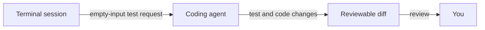

# equestrian

Equestrian lets you work with a coding agent at your keyboard while a second
agent keeps house. The supervisor retains context across sessions, measures
friction, queues approvals, and applies your steering rules.

## Install

Install equestrian 0.1.0 with Homebrew:

```sh
brew install stevenjpx2/taps/equestrian
```

## Set up the coding session

In your repository, create `equestrian.config.ts` to choose the coding agent's
model, MCP tools, and supervisor settings:

```ts
export default {
  model: "anthropic/claude-sonnet-5-5",
  mcps: ["filesystem", "web", "subagents"],
  supervisor: { memory: true, approvals: true, steering: "./rules" },
};
```

The supervisor uses a lower-cost model by default. Equestrian runs its own
small, MCP-only agent loop, so you do not need a separate agent host.

## Add a regression test

From the repository you want to work on, open a terminal session:

```sh
equestrian
```

Ask in the opened session: "Add a regression test for an empty input."



Review the regression test and any accompanying code changes as a diff before
keeping them. Check that the test covers the empty-input case you asked for.

## Choose the session's grant

Start with the `repo-work` profile to select the grant for the session:

```sh
equestrian --profile repo-work
```

The grant covers the files the agent can access, the hosts it can reach, and
the tools it can use. MCP servers run in separate sandboxes under that grant.
The barn daemon brokers network requests.

## Keep context and reduce friction

Return to repository work with context retained across sessions. The
supervisor measures paper cuts to spot recurring friction.

## Review approvals and steer the agent

The supervisor queues approvals for your review while you work. Use the
approval queue to decide on requests that need your permission. Steering
rules in `./rules` apply deterministic guidance when the session's context
matches a rule.

## Work in the terminal or browser

Use the terminal UI at your keyboard or the browser UI for the same coding,
review, approval, and steering workflow. MCP servers provide filesystem,
web, and subagent tools; skills are available as `skill://` resources.

## Roadmap

- [ ] Deliver the terminal coding workflow and matching browser workflow
- [ ] Add supervisor memory, friction measurements, approvals, steering, and grants
- [ ] Publish equestrian 0.1.0 to the wrkhse/tap tap

## More

- [Design](https://github.com/wrkhse/equestrian/issues/1)
- [Harness notes](https://github.com/wrkhse/tack/issues/26)
- [Workhorse philosophy](https://github.com/wrkhse/workhorse/blob/main/PHILOSOPHY.md)
